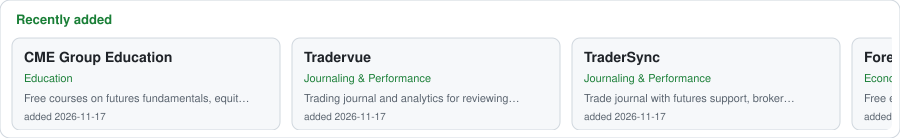

<!-- GENERATED FILE — do not edit by hand. Edit THE_RESOURCES_TABLE_NEW.csv or config.yaml and run `make generate`. -->

# Quint

A curated, generated list of resources for trading MNQ1! (Micro E-mini Nasdaq-100 futures) and passing funded-account evaluations.

**20 resources** · [Recommend one](../../issues/new?template=recommend-resource.yml)

> [!WARNING]
> Nothing here is financial advice. Futures trading carries substantial risk of loss. Always read a prop firm's current rules on its own site — they change often.

<picture>
  <source media="(prefers-color-scheme: dark)" srcset="assets/recently-added-dark.svg">
  
</picture>

## Contents

- [Contract Specs & Market Structure](#contract-specs--market-structure)
- [Prop Firms & Funded Accounts](#prop-firms--funded-accounts)
  - [Evaluation Firms](#evaluation-firms)
  - [Risk & Rule Tools](#risk--rule-tools)
- [Platforms & Data](#platforms--data)
  - [Charting](#charting)
  - [Execution Platforms](#execution-platforms)
  - [Data Feeds](#data-feeds)
- [Indicators & Scripts](#indicators--scripts)
- [Backtesting & Research](#backtesting--research)
- [Economic Calendar & News](#economic-calendar--news)
- [Journaling & Performance](#journaling--performance)
- [Education](#education)

## Contract Specs & Market Structure

> Official references for how MNQ trades — tick size, point value, sessions, margins.

- [CFTC Commitments of Traders](https://www.cftc.gov/MarketReports/CommitmentsofTraders/index.htm) by [CFTC](https://www.cftc.gov) — Weekly positioning reports for futures markets, including Nasdaq-100 contracts.
- [CME Group Trading Hours](https://www.cmegroup.com/trading-hours.html) by [CME Group](https://www.cmegroup.com) — Session times and holiday schedules for equity index futures — check before holidays and early closes.
- [Micro E-mini Nasdaq-100 (MNQ)](https://www.cmegroup.com/markets/equities/nasdaq/micro-e-mini-nasdaq-100.html) by [CME Group](https://www.cmegroup.com) — Official MNQ product page: $2 × Nasdaq-100 index, 0.25-point tick ($0.50), contract specs, trading hours, and margins.

## Prop Firms & Funded Accounts

> Futures evaluation programs and tools for staying inside their rules.

### Evaluation Firms

> Futures prop firms that offer funded-account evaluations.

- [Apex Trader Funding](https://apextraderfunding.com) — Futures evaluation accounts with trailing-drawdown rules; terms change frequently, so check the firm's own site.
- [Take Profit Trader](https://takeprofittrader.com) — Futures prop firm offering evaluation-to-funded accounts.
- [Topstep](https://www.topstep.com) — Futures prop firm with funded-account evaluations; read its current rules for drawdown and consistency requirements.

### Risk & Rule Tools

> Calculators and trackers for daily loss limits, trailing drawdown, and position sizing.

_Nothing here yet — [recommend a resource](../../issues/new?template=recommend-resource.yml)._

## Platforms & Data

> Where you chart, route orders, and get market data.

### Charting

- [Sierra Chart](https://www.sierrachart.com) — Low-latency charting and trading platform popular for footprint and order-flow analysis.
- [TradingView](https://www.tradingview.com) — Browser-based charting with MNQ1! continuous contracts, alerts, and Pine Script.

### Execution Platforms

- [NinjaTrader](https://ninjatrader.com) — Futures trading platform and brokerage; NinjaScript (C#) for custom indicators and strategies.
- [Tradovate](https://www.tradovate.com) — Cloud-based futures trading platform used by many prop firms.

### Data Feeds

- [Rithmic](https://www.rithmic.com) — Futures market data and order routing used by many prop firms and third-party platforms.

## Indicators & Scripts

> Indicators, strategies, and the languages used to write them.

- [Pine Script Docs](https://www.tradingview.com/pine-script-docs/) by [TradingView](https://www.tradingview.com) — Official reference and user manual for TradingView's indicator and strategy language.

## Backtesting & Research

> Frameworks for testing an edge before risking an evaluation on it.

- [backtrader](https://github.com/mementum/backtrader) by [mementum](https://github.com/mementum) — Python framework for backtesting and trading strategies with support for futures data feeds.
- [vectorbt](https://github.com/polakowo/vectorbt) by [polakowo](https://github.com/polakowo) — Vectorized Python backtesting for testing many parameter combinations quickly.

## Economic Calendar & News

> Scheduled events that move the Nasdaq — know them before you size up.

- [BLS Release Schedule](https://www.bls.gov/schedule/news_release/) by [U.S. Bureau of Labor Statistics](https://www.bls.gov) — Official dates for CPI, jobs reports, and other releases that move index futures.
- [FOMC Meeting Calendar](https://www.federalreserve.gov/monetarypolicy/fomccalendars.htm) by [Federal Reserve](https://www.federalreserve.gov) — Official FOMC meeting dates, statements, and minutes.
- [Forex Factory Calendar](https://www.forexfactory.com/calendar) — Free economic calendar with impact ratings, filterable to USD events.

## Journaling & Performance

> Trade journals and analytics for finding and fixing leaks.

- [TraderSync](https://tradersync.com) — Trade journal with futures support, broker imports, and performance analytics.
- [Tradervue](https://www.tradervue.com) — Trading journal and analytics for reviewing executions and tracking metrics over time.

## Education

> Courses and reference material on futures and index trading.

- [CME Group Education](https://www.cmegroup.com/education.html) by [CME Group](https://www.cmegroup.com) — Free courses on futures fundamentals, equity index products, and risk management.

## Contributing

Open a [resource recommendation](../../issues/new?template=recommend-resource.yml), or with maintainer access:

```bash
make add-resource DISPLAY_NAME="Name" CATEGORY="Category" LINK="https://..." DESCRIPTION="..."
make help   # every target
```
